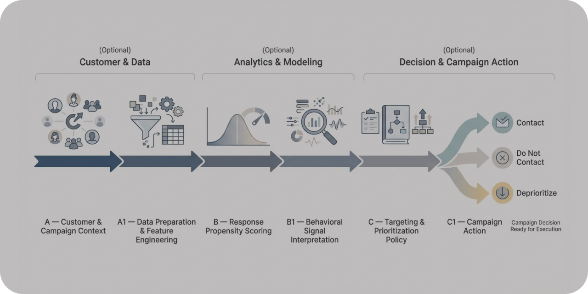

# CampaignSense

### *CRM Analytics para segmentação de clientes, modelagem de propensão e priorização de campanhas.*




O **CampaignSense** é um case de CRM Analytics que investiga como dados comportamentais de clientes e históricos de campanhas podem apoiar a segmentação da base, a estimativa de propensão à resposta e a priorização de contatos.

O case combina análise exploratória, segmentação comportamental e modelagem preditiva para estruturar critérios analíticos de priorização. A abordagem também contempla a avaliação econômica de campanhas, conectando os scores de propensão ao custo de contato e ao retorno financeiro esperado.

A proposta é explorar como diferentes técnicas analíticas podem ser integradas em um processo de decisão orientado a dados, desde a compreensão do perfil dos clientes até a avaliação de estratégias de direcionamento de campanhas.

---

## 1. O que foi construído

O CampaignSense reúne cinco entregas principais:

* **Análise e preparação dos dados:** auditoria da base de clientes, avaliação de qualidade e análise exploratória orientada ao problema de negócio.
* **Segmentação comportamental:** identificação de grupos de clientes com características e padrões de consumo semelhantes.
* **Modelagem de propensão:** treinamento e comparação de modelos preditivos para estimar a probabilidade de resposta às campanhas.
* **Priorização de contatos:** conversão dos scores de propensão em critérios de direcionamento e priorização de clientes.
* **Avaliação econômica:** estruturação de cenários para analisar o retorno financeiro esperado das campanhas considerando critérios econômicos.

A organização do case busca conectar exploração de dados, modelagem e avaliação econômica em um fluxo analítico coerente, no qual os resultados dos modelos são utilizados como insumos para decisões de marketing.

---

## 2. Abordagem analítica

A abordagem parte de um problema recorrente em campanhas de marketing: a distribuição de contatos sem uma diferenciação suficientemente objetiva entre clientes com distintos perfis comportamentais e probabilidades de resposta.

O processo analítico é organizado em quatro frentes complementares.

### Análise exploratória e segmentação

A análise exploratória investiga a distribuição das características dos clientes, seus padrões de consumo, o comportamento de compra e o histórico de participação em campanhas.

A segmentação comportamental complementa essa etapa, buscando identificar grupos com características semelhantes e fornecer uma visão estruturada da base de clientes.

### Modelagem de propensão

A modelagem preditiva estima a probabilidade de resposta às campanhas a partir das características disponíveis na base.

O case contempla a comparação entre modelos candidatos, incluindo LightGBM e XGBoost, para avaliar alternativas de modelagem e selecionar um modelo conforme os critérios definidos na análise.

### Priorização de clientes

Os scores de propensão são utilizados como insumos para estruturar regras de priorização, permitindo explorar estratégias de direcionamento de contatos com base na resposta estimada e nos critérios de negócio.

A intenção é ir além da classificação individual dos clientes, considerando como os resultados analíticos podem orientar a distribuição dos esforços de campanha.

### Avaliação econômica

A avaliação econômica conecta as estratégias de priorização aos custos de contato e ao retorno esperado das campanhas.

Essa etapa permite estruturar cenários de decisão e analisar como diferentes critérios de seleção de clientes podem influenciar os resultados financeiros estimados.

As estimativas econômicas dependem das premissas adotadas, dos custos considerados e das características da base utilizada. Elas não representam, por si só, resultados observados em campanhas reais.

---

## 3. Pipeline analítico

O fluxo de trabalho do CampaignSense é composto pelas seguintes etapas:

1. Auditoria e preparação dos dados de clientes.
2. Análise exploratória orientada ao problema de negócio.
3. Segmentação comportamental da base de clientes.
4. Treinamento e validação dos modelos preditivos.
5. Comparação dos modelos candidatos e seleção do modelo final.
6. Conversão dos scores em critérios de priorização.
7. Avaliação de cenários e estimativa de impacto financeiro esperado.
8. Organização dos resultados e geração de artefatos analíticos.

A sequência conecta preparação dos dados, investigação, modelagem e avaliação econômica, mantendo a priorização de clientes como o elo entre os resultados preditivos e a decisão de campanha.

---

## 4. Resultados e entregas

O CampaignSense estrutura uma abordagem analítica para explorar a relação entre comportamento dos clientes, propensão à resposta e priorização de campanhas.

As principais entregas do case são:

* Segmentação comportamental dos clientes.
* Modelagem preditiva da propensão à resposta.
* Comparação de modelos candidatos de Machine Learning.
* Critérios de priorização baseados nos scores produzidos.
* Avaliação econômica de estratégias de direcionamento de campanhas.
* Notebooks, métricas, tabelas, visualizações e documentação de apoio à análise.

Os artefatos gerados permitem acompanhar as etapas de investigação e modelagem, além de documentar os elementos utilizados na avaliação das estratégias de priorização.

O case demonstra uma abordagem técnica de CRM Analytics. Os resultados obtidos no conjunto de dados utilizado não devem ser interpretados automaticamente como evidência de desempenho em campanhas reais ou de retorno financeiro efetivamente realizado.

---

## 5. Estrutura do projeto

```text
campaignsense/
├── data/
│   ├── raw/
│   └── processed/
│
├── src/
│   ├── evaluation.py
│   └── paths.py
│
├── notebooks/
│   ├── 01-data_audit_eda.ipynb
│   ├── 02-eda_decision.ipynb
│   ├── 03-segmentation.ipynb
│   ├── 04-modeling.ipynb
│   └── 05-profit_targeting.ipynb
│
├── references/
│   ├── 01_dicionario_de_dados.md
│   └── campaignsense-results.png
│
├── reports/
│   ├── plots/
│   ├── metrics/
│   ├── tables/
│   └── campaignsense_summary.md
│
└── README.md
```

| Diretório ou arquivo | Responsabilidade |
|---|---|
| `data/raw/` | Dados de origem utilizados no case |
| `data/processed/` | Dados preparados para as etapas analíticas |
| `src/` | Funções auxiliares para avaliação e gerenciamento de caminhos |
| `notebooks/` | Auditoria, análise exploratória, segmentação, modelagem e avaliação econômica |
| `references/` | Dicionário de dados e imagem de resultados |
| `reports/plots/` | Visualizações geradas durante as análises |
| `reports/metrics/` | Métricas e resultados de avaliação |
| `reports/tables/` | Tabelas produzidas durante o processo analítico |
| `reports/campaignsense_summary.md` | Documento de consolidação dos resultados |

---

## 6. Reprodução

O case foi organizado em notebooks Python, com funções auxiliares para avaliação e gerenciamento de caminhos.

### Pré-requisitos

* Python 3.10.12
* Ambiente virtual Python
* Dependências listadas no arquivo `requirements.txt`

### Configuração do ambiente

Clone o repositório e acesse o diretório:

```bash
git clone https://github.com/smalldatalabbr/campaignsense.git
cd campaignsense
```

Crie e ative um ambiente virtual:

```bash
python -m venv .venv
```

**Linux e macOS**

```bash
source .venv/bin/activate
```

**Windows (PowerShell)**

```powershell
.\.venv\Scripts\Activate.ps1
```

Instale as dependências:

```bash
pip install -r requirements.txt
```

Após a instalação, abra os notebooks na ordem numerada para acompanhar o fluxo de análise, segmentação, modelagem e avaliação econômica.

A reprodução completa depende da disponibilidade dos dados utilizados e das configurações exigidas pelos notebooks. Os procedimentos acima refletem a estrutura de execução documentada no case; requisitos adicionais devem ser verificados nos arquivos do repositório.

---

## 7. Limitações e considerações analíticas

O CampaignSense utiliza uma base pública de dados para explorar técnicas de segmentação, modelagem de propensão e priorização de campanhas.

Os resultados estão condicionados às características, à qualidade e à representatividade dos dados disponíveis, bem como às decisões de preparação, seleção de variáveis, treinamento e avaliação dos modelos.

A probabilidade estimada de resposta não equivale necessariamente ao efeito incremental de uma campanha. Para estimar causalmente o impacto de uma ação de marketing, seriam necessários dados e métodos apropriados à avaliação de incrementalidade, como experimentos controlados ou abordagens causais adequadas.

Da mesma forma, as estimativas econômicas dependem das premissas de custo, receita e retorno adotadas. Elas devem ser interpretadas como cenários analíticos, não como garantia de resultados financeiros.

O case tem finalidade demonstrativa e não deve ser utilizado diretamente em ambientes produtivos sem validação adicional dos dados, dos modelos, das premissas econômicas e dos processos operacionais.

---

## 8. Fontes e referências

O case utiliza o conjunto público **Customer Personality Analysis**, disponibilizado no Kaggle por imakash3011.

**Fonte dos dados:** [Customer Personality Analysis — Kaggle](https://www.kaggle.com/datasets/imakash3011/customer-personality-analysis)

O conjunto contém atributos demográficos e comportamentais de clientes, informações de consumo, hábitos de compra e registros de resposta a campanhas de marketing. Essas informações permitem explorar padrões de comportamento, construir segmentos e investigar a aplicação de modelos preditivos à priorização de contatos.

A base é utilizada como fonte de dados para fins analíticos e demonstrativos. O projeto não possui vínculo comercial ou institucional com o Kaggle ou com empresas eventualmente mencionadas no contexto de inspiração do case.

---

## 9. Tecnologias

* **Python:** implementação do fluxo analítico e execução dos notebooks.
* **Pandas:** manipulação, preparação e análise dos dados.
* **NumPy:** operações numéricas e suporte aos cálculos analíticos.
* **SciPy:** recursos estatísticos e métodos numéricos.
* **Scikit-learn:** ferramentas de preparação, modelagem e avaliação de Machine Learning.
* **LightGBM:** modelagem preditiva baseada em gradient boosting.
* **XGBoost:** alternativa de modelagem baseada em gradient boosting.
* **Matplotlib e Seaborn:** visualização e exploração dos resultados.

---

## Licença

Este repositório é licenciado sob a [MIT License](LICENSE).
